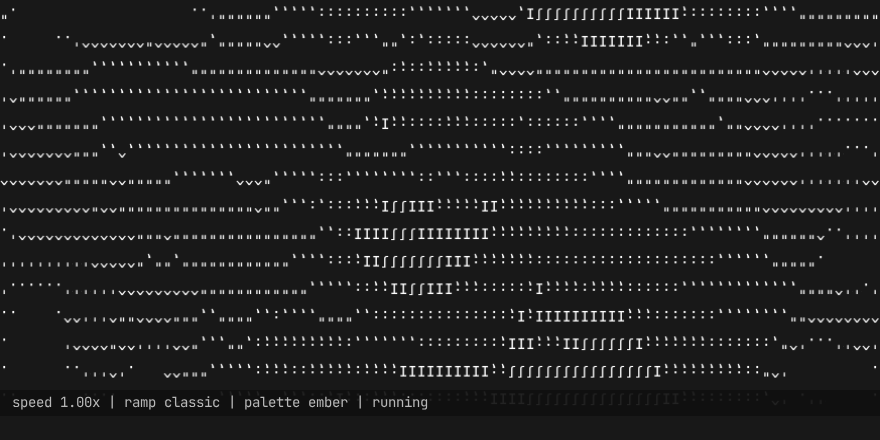
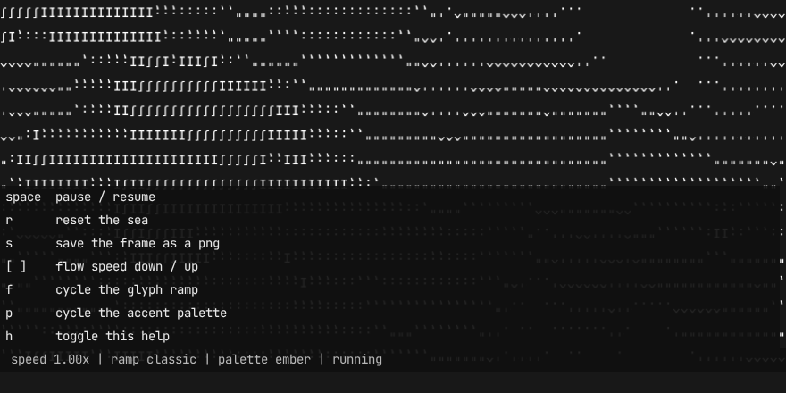

# ascii-machine-web

A living sea of characters in your browser, that you can stir with the mouse.

The screen fills with a flow field: a continuous drift of characters that looks
like ink suspended in moving water. Your cursor is inside that field, and it
reacts to you.

**Live:** <https://gloriouschicken.github.io/ascii-machine-web/>



This is the browser version of [ascii-machine](https://github.com/GloriousChicken/ascii-machine),
the terminal app. Same algorithm, same look, same interaction.

## The mouse

| Action | Effect |
|---|---|
| Move | A soft wake follows the cursor |
| Click | A pulse |
| Drag | A plume ploughed through the current |

The sea itself is a single gray; the cells you disturb are lit in an accent
colour, so the interaction is visible at a glance. Touch works the same way.

## The keys

| Key | Action |
|---|---|
| `space` | Pause / resume |
| `r` | Reset the sea |
| `s` | Save the current frame as a PNG |
| `[` / `]` | Flow speed down / up |
| `f` | Cycle the glyph ramp |
| `p` | Cycle the accent palette |
| `h` | Toggle the help |



## Sharing a sea

The sea is fully described by its seed, and the seed is in the URL. Copy the
address bar and the link reproduces that exact sea, at any window size.

- `?seed=12345` — a specific sea. Without it, one is generated and put in the
  URL, so the address bar always describes what is on screen.
- `?steps=200` — run exactly this many simulation steps and stop. This makes
  the grid deterministic, which is what the tests use.

## Running it locally

```sh
npm install
npm run dev
```

Then build and preview the production bundle:

```sh
npm run build
npm run preview
```

## How it works

**The simulation** is a curl of fractal value noise, with semi-Lagrangian
advection carrying a density of characters across the grid. The noise source
and the potential are *panned* through oversized tiles with toroidal
wraparound: a static source makes the density converge to a stationary field
and the sea visibly freezes, so panning is what keeps it alive. There is a
regression test for exactly that.

**The rendering** is WebGL 2. Every character of every ramp is rasterized once
into a glyph atlas, and each frame is a single instanced draw call with one
quad per cell. Drawing it with Canvas 2D would mean thousands of
text-shaping operations per frame instead.

**The grid** is canonical: the simulation always runs at 160x60 and is
resampled for display. Without that, the same seed at two window sizes gives
two completely different seas, because the noise grids are sized in absolute
cells.

A frame costs about 1.8ms, against a 16.7ms budget at 60Hz.

## Tests

```sh
npm test          # the simulation, the generator and the palette
npm run test:e2e  # the parity tests, in a real browser
```

The parity tests check five seed-independent invariants rather than comparing
grids against the terminal app, because the two deliberately use different
random generators. Every expected value was measured against the terminal app
with `tools/reference_stats.py`:

- the sea keeps moving rather than freezing
- the character histogram has the terminal app's shape
- a click lights exactly the clicked cell
- a drag lights the whole path and nothing off it
- the same seed gives the same sea, at any window size

## Deploying

Pushes to `main` are built and deployed to GitHub Pages by
`.github/workflows/deploy.yml`.

## Licence

The code is MIT licensed. The bundled font is JetBrains Mono, under the SIL
Open Font License.
